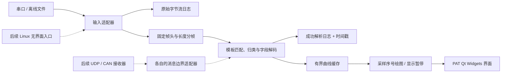

# PAT 参数分析、串口与空间图表统一设计

> 状态：需求分析与设计草案；首版实现与剩余验收进度见[技术变更路线](技术变更路线.md)第 6 节。依据 `readme.md` 的初始需求 1–5、详细需求 1–7，以及本文件第 9 章确认事项，日期：2026-09-17。
>
> 技术选型更新（2026-09-17）：本功能将并行开发后集成到 PAT，采用现有 C++20、Qt 6 Widgets/Charts、CMake 方案。具体改造项、接口与版本规则见 [PAT 技术变更路线](技术变更路线.md)；本文的需求、协议语义和验收口径继续适用。

> 协议补充（2026-09-18）：CP01-B3 备惯导导航输出协议已提供固定 86 字节帧及低 8 位累加和规则，PAT 已增加可选 `sum8` 校验；本草案下文“校验仅预留”的文字记录的是此前尚无实际协议样例时的范围。当前实现与待确认项见 [CP01-B3 模板说明](CP01-B3导航模板说明.md)和[技术变更路线](技术变更路线.md)。

> 文档合并（2026-09-22）：原 `PAT功能需求.md` 的产品范围、格式管理、画布交互、信号属性和检索要求已归并到本文第 14 章及相关专题章节。本文自此作为 PAT 唯一的总体需求与设计文档；协议 JSON 的逐字段编辑方法继续由[协议模板 JSON 编辑指南](协议模板JSON编辑指南.md)承载。

## 1. 结论

首版在现有 PAT 中集成 **macOS C++/Qt 桌面功能**，以串口实时采集、离线解析、协议模板、双日志和曲线查看为交付范围。串口使用 Qt Serial Port；串口号、波特率、数据位、校验位、停止位、流控和应用层读取超时由连接配置管理。`QSerialPort` 可设置波特率等参数；无数据超时由应用层计时并决定告警或重连，230400 波特率仍需在目标设备上验证。[QSerialPort](https://doc.qt.io/qt-6/qserialport.html)。

解析核心与桌面界面分开，使后续能够增加**可配置监听地址和端口的 UDP 接收器**，并在 Linux 服务器上复用解析及日志能力，按届时的部署要求提供无界面进程。CAN 适配留在后续阶段，待设备型号、系统驱动和报文样例确定后实现；可评估 Qt Serial Bus 或设备厂商接口，不能在硬件未定时承诺适配。[Qt Serial Bus](https://doc.qt.io/qt-6/qtserialbus-index.html)。

当前 `serialtools.html` 继续作为轻量离线工具使用。PAT 内的新模块复用一套固定帧头、固定总长度及字段解码规则，供离线和实时输入调用；PAT 原有无帧头的固定记录格式保持兼容。

## 2. 需求范围与验收口径

| 需求 | 拟实现行为 | 验收要点 |
| --- | --- | --- |
| 串口提帧和归类（首版） | 按模板的固定帧头与固定总长度连续提帧；按模板、指定字段或完整帧内容归类 | 噪声、跨读取块半帧和连续多帧不导致错位；分类结果可复核 |
| 文本跳过无效内容 | 离线文本按明确的十六进制词法读取，跳过不符合格式的片段并显示跳过数量 | 混合文本中有效字节顺序保持不变；无有效数据时给出错误 |
| 原始帧 TXT/CSV | 首行表头，每帧一行；TXT 的字节用空格分隔，CSV 每字节一列 | 无统计行、分类标题或空白分组行；保留原有数据顺序 |
| 协议模板（首版） | 从本地文件加载、校验并预览模板；描述固定分帧、字段位置、类型、端序、比例尺、物理偏移、单位和定义；校验方式只预留扩展点 | 用已知原始帧可得到预期物理值；无效模板报出字段及原因 |
| 串口实时输入（首版） | 配置端口、波特率、数据位、奇偶校验、停止位、流控和超时后持续采集、解码 | 可连接、断开、报错及重连；230400 波特率、100 字节/帧、50 帧/秒下不阻塞界面 |
| 离线解析（首版） | 打开原始二进制流、十六进制文本及本程序生成的原始日志，复用同一模板解码 | 同一字节流在线和离线得到相同帧与字段值 |
| 双日志（首版） | 同时记录收到的原始字节流和成功解析的帧；成功解析记录包含主机时间戳 | 绘图暂停时两类日志仍增长；未成功解析数据不进入成功日志 |
| 实时折线图与多组同显（首版） | 数值字段以成功解析帧的采样序号为横轴，可选多条曲线 | 图例有名称、颜色、单位；长时运行内存有界；无需跨数据源实时对时 |
| 暂停与图像交互（首版） | “暂停显示”只停止图表刷新，采集、解析及双日志继续；支持拖拽平移、缩放、恢复实时视图 | 暂停期间日志持续写入；恢复后曲线可追到最新数据 |
| UDP、Linux、CAN（后续） | UDP 可配置监听地址/端口；Linux 服务器复用无界面解析核心；CAN 按确定设备接入 | 分别在目标网络、服务器和 CAN 硬件上验收，不作为首版完成条件 |

**术语约定**：首版的“帧”是从串口字节流按固定帧头和固定总长度提取的数据单元。后续 CAN 消息和 UDP 数据报已有各自边界，适配时不能直接套用串口的帧头扫描。

**当前范围**：首版只接收和解析，不主动发送；CRC/校验保留模板与解码器扩展点，尚不指定算法。触发器、报警、DBC 导入、跨源同步和 CAN 设备接入不进入首版验收。

## 3. 推荐架构



- **输入适配器**负责串口连接配置、读取和关闭；任何一次 `read()` 的字节数都不等同于一帧。串口原始日志回放用同一字节输入接口，PAT 旧格式文件仍走兼容的固定记录路径。UDP 接收器将来增加监听地址、端口及数据报元数据，CAN 接收器将来保留 CAN ID、DLC 和帧类型，不改变首版串口分帧器。
- **原始日志**在实时采集时于分帧前顺序写入收到的所有字节，包括噪声和不完整尾部；建议使用 `.bin`，以便原样离线重放。导入已有文件时不默认复制一份原始日志。成功解析日志在完成字段解码后写入，一帧一行，并记录该帧完成时的主机时间戳。两条写入路径都与图表刷新无关。
- **分帧器**维护跨读取块的缓冲区，按固定帧头和总长度提帧，并在遇到噪声时重新同步；对校验接口预留调用位置，不在当前版本假定 CRC 算法。解析错误和跳过字节数单独计数。
- **模板解码器**是独立的纯逻辑模块。先取得原始整数或浮点值，再计算 `物理值 = 原始值 × 比例尺 + 物理偏移量`；记录单位、字段定义和解析质量。所有在线和离线路径调用相同实现。
- **线程与队列**：串口读取、分帧/解码和日志写入不占用界面线程；界面只接收批量绘图样本。Qt 的对象线程归属和跨线程信号必须按事件循环规则处理。[Threads and QObjects](https://doc.qt.io/qt-6/threads-qobject.html)。队列、未完成帧缓冲和曲线缓存设上限，日志写入失败或队列溢出必须报错并计数。
- **绘图与记录解耦**：“暂停显示”只关闭图表刷新/自动跟随；后台仍执行读取、分帧、解码和双日志写入。恢复时从有界曲线缓存绘制最近窗口，历史全量数据由日志回放。PAT 现有 Qt Charts 抽稀逻辑只作用于显示，并需改为按批次增量更新。

### 数据对象

首版内部可定义 `ByteChunk(source_id, payload)` → `Frame(template_id, raw_bytes, completed_at)` → `DecodedFrame(sample_index, fields, quality)`。`sample_index` 只在成功解码后从 0 连续递增，同一帧的各字段共用该序号，作为绘图横轴；`completed_at` 是成功解析日志的主机时间戳，不承担多源实时对时。原始日志保存连续字节流，不插入时间戳或诊断文本。未来的 UDP/CAN 元数据由各自适配器提供，不写入串口原始字节流。

## 4. 协议模板设计

建议使用**带版本号的 JSON 文件**，便于交换、校验和回放。首版模板包含固定帧头、**含帧头的固定总帧长**及字段定义；一份模板对应一种可匹配的串口消息类型。模板加载时校验帧头、帧长、字段范围、名称唯一性、类型长度、比例尺和端序；会话记录保存模板版本或快照，避免后续改模板使历史结果不可复现。

**设备连接配置与协议模板分开**：串口号、波特率、数据位、奇偶校验位、停止位、流控和超时属于连接配置；帧头、帧长、端序和信号定义属于协议模板。UDP 阶段增加本地监听地址和端口配置，不把网络地址写进字段定义。

以下结构展示与 PAT 现有字段名兼容的模板扩展方向，字段细节仍需由真实协议样例定稿：

```json
{
  "schema_version": 2,
  "template_id": "sensor_v1",
  "record_size": 4,
  "endianness": "little",
  "framing": { "kind": "fixed_header", "header_hex": "AA55", "frame_length": 4 },
  "signals": [
    {
      "name": "温度",
      "byte_offset": 2,
      "value_type": "int16",
      "scale": 0.1,
      "bias": -40,
      "unit": "°C",
      "description": "探头温度"
    }
  ]
}
```

该例中 `AA 55 90 01` 的 `int16` 原始值为 400，解码后为 `0 °C`。`byte_offset` 从帧首字节按 0 开始计数；`bias` 是公式中的物理值偏移，两者在界面上必须分开命名。`framing.frame_length` 含帧头，并与 `record_size` 一致；旧 PAT 格式没有 `schema_version` 和 `framing` 时继续按固定记录读取。字段级端序覆盖如需支持，待实际协议确定后再扩展。

拟支持的首版字段类型为 8/16/32 位有符号与无符号整数及 IEEE 754 的 32/64 位浮点数；字段定义可包含文字说明，枚举映射按实际样例扩展。校验规则只保留可扩展字段/接口，未配置时不执行校验；等拿到明确算法和样例后再实现，避免把“固定帧头+长度”误认为已验证帧内容。可变长、转义、非字节对齐字段和 DBC 导入不进入首版模板。未来 CAN 位字段必须另行定义 Intel/Motorola 位编号和跨字节规则，不能只靠“端序”推断。

## 5. 实时界面与导出

PAT 主界面增加串口/文件来源切换、连接参数、模板选择与校验、实时帧状态和运行状态；复用现有信号树及曲线区。连接后可勾选多个数值字段；实时会话横轴统一使用成功解析帧的**采样序号**，默认同单位叠加、异单位分图，已有的混合单位合并功能继续由 PAT 的分组规则处理。图表支持图例、拖拽平移、滚轮缩放、区域复位及“跟随最新样本”。

“暂停显示”只停止绘图更新和自动跟随，不停止采集、分帧、解码或日志记录；用户可拖拽检查当前缓存内的历史。恢复后绘制最新窗口，已移出内存窗口的历史可通过离线日志回放查看。“停止采集”是独立操作，不与暂停显示混用。首版不设计“暂停解码”和恢复后追赶的积压队列。

后台持续保存以下**两类日志**，并保留按需导出，防止原始字节与工程值混淆：

| 文件 | 格式与记录 | 用途 |
| --- | --- | --- |
| 原始字节流日志 | `.bin`，逐字节原样追加收到的数据，不混入时间戳、统计或分帧信息 | 无损离线重放及排查解析失败 |
| 成功解析日志 | `.csv`，首行 `时间戳,字段1,字段2,…`，之后每个成功解析帧一行；时间戳取主机完成该帧解码的时间，采用带时区的 ISO 8601 格式 | 查看工程值；仅增加用户确认的时间戳 |
| 原始帧 TXT/CSV（按需导出） | TXT 首行 `帧数据` 且每帧一行；CSV 首行 `字节1,字节2,…` 且每帧一行 | 延续现有工具的原始帧交付格式 |

成功解析日志不写失败帧、统计说明行或分类标题；采样序号只用于内部对齐与绘图，默认不增加到日志列。若同一连接使用多个消息模板，则按模板分别写成功解析 CSV，以保持各文件表头固定，仍属于同一类日志。连接状态、跳过字节数和解析错误显示在界面及独立诊断信息中。两类日志由独立写入路径维护；绘图暂停时继续写入，发生磁盘写入失败时必须告警，不能显示为“正常记录”。

## 6. 可行性与技术栈比较

| 方案 | 适配情况 | 主要代价 | 结论 |
| --- | --- | --- | --- |
| **PAT 原生 C++20 + Qt 6 Widgets/Charts**；Qt Serial Port、CMake | 复用 PAT 的格式模型、信号树和图表交互；解析核心可供后续无界面入口调用 | 需新增流式分帧、双日志和实时会话，改造图表增量刷新与模板扩展 | **当前选定方案**，修改清单见[技术变更路线](技术变更路线.md) |
| 独立 Python + PySide6；pySerial、pyqtgraph | 可较快形成独立应用 | 与 PAT 同时维护两套运行时、解析模型和图表界面，集成需额外通信层 | 作为早期评估记录，不作为当前实施方案 |
| 浏览器前端 + 独立本地服务 | 后续 Linux 服务器与远程访问较自然 | 首版 macOS 本机使用要部署服务，增加启动、权限和运维步骤 | 等确认远程访问需求后再评估 |

**首版吞吐量**：100 字节/帧 × 50 帧/秒 = **5,000 字节/秒**，原始流约 **18 MB/小时**（十进制，不含日志文件系统开销）。按常见 8N1 串口配置估算，每字节约占 10 个线路位，即约 50 kbit/s，约为 230400 波特率名义线路速率的 **21.7%**。这是容量估算，不等于设备实测或无丢帧保证；实际数据位、校验位、停止位改变后需要重算。`QSerialPort::setBaudRate()` 接收整数波特率，但是否可用取决于适配器与驱动。[QSerialPort](https://doc.qt.io/qt-6/qserialport.html)。

**分项可行性**：在上述负载下，串口读取、固定长度分帧、双日志和多曲线绘图没有明显吞吐瓶颈，但仍需在真实 macOS 串口设备上做持续采集验证。UDP 后续使用 Qt Network 的 `QUdpSocket`，配置本地监听地址和端口；单播/组播及数据报内分帧方式待样例确认。[QUdpSocket](https://doc.qt.io/qt-6/qudpsocket.html)。CAN 适配条件仍由设备决定，不能在型号缺失时承诺 macOS 或 Linux 的具体支持。[Qt Serial Bus](https://doc.qt.io/qt-6/qtserialbus-index.html)。

**发布方式**：首版提供包含所需 Qt 运行库的 macOS PAT 应用包，使用 Qt/CMake 的应用包与部署工具，并在未安装 Qt 的目标机器验证。Linux 服务器阶段共用解析核心，届时根据机器型号和运维方式选择命令行程序或常驻服务，不要求运行 Widgets/Charts 界面。串口驱动、系统授权及应用签名需在目标系统上检查。[Qt macOS 部署文档](https://doc.qt.io/qt-6/macos-deployment.html)。

## 7. 建议实施顺序与验证

1. **首版协议样例定稿**：收集固定帧头、固定帧长、字段类型及人工核对值，确定成功解析 CSV 的列名和时间戳格式。校验算法保持预留。
2. **PAT 共享核心与离线流程**：映射协议模板，提取单帧字段解码器，增加跨读取块定长分帧、原始 `.bin` 回放和原始帧 TXT/CSV 导出。验证旧格式兼容、端序、有符号数、比例尺、半帧、噪声与混合文本。
3. **macOS 串口实时流程与 PAT 集成**：独立模块先实现可配置串口、分帧和两类日志；再接入 PAT 信号树、采样序号曲线、多字段同显、暂停显示、平移与缩放。验证暂停期间日志不停写及在线/离线结果一致。
4. **峰值测试与 macOS 发布**：用带已知序号的模拟流及真实设备，以 230400 波特率、100 字节/帧、50 帧/秒验证持续采集、日志完整性、界面响应、CPU 和内存；打包 PAT 并在目标 macOS 机器实测。
5. **后续阶段**：增加可配置地址/端口的 UDP 接收器；明确 Linux 服务器型号和运行方式后提供无界面入口；取得 CAN 适配器资料和样例后增加设备适配及模板扩展。

首版的**待验证验收基线**是：在目标 macOS 机器上按上述峰值连续运行至少 1 小时，模拟输入的成功帧数、成功日志行数及期望值一致，原始日志逐字节与输入相同；绘图暂停期间两类日志持续增长，恢复后绘制最新窗口。图表建议分批刷新（例如每 100 ms 一次），显示缓存有界、磁盘错误和队列溢出明确告警。真实设备若有传输错误，应与应用丢弃分开统计；最终验收时长和同时显示的字段数待确认。

## 8. 开发前需要确认的事项

第 9 章已确定目标系统、首版来源、帧边界、日志类别、横轴、暂停含义和峰值负载。以下事项仍影响最终模板或后续阶段，不在首版中猜测：

1. **串口协议样例**：实际帧头、总帧长、字段位置、数据类型、端序、比例尺、偏移和期望解析值；以后启用校验时再确定算法、覆盖范围和失败处理。常规串口 API 配置数据位、校验位、停止位等，没有独立的起始位参数；若“起停位”中的起始位有特殊含义，需提供设备说明。[QSerialPort](https://doc.qt.io/qt-6/qserialport.html)。
2. **日志与离线文本**：日志保存位置、保留/轮转策略、磁盘满时停止记录还是停止采集；混合文本中时间戳或地址可能像合法十六进制，应约定数据区提取规则并提供预览，不能仅靠跳过非法字符判断。
3. **界面容量**：要同时显示的字段数量、默认历史窗口时长、最长会话和首次发布所需的 macOS 版本；这些决定实际性能验收及打包测试矩阵。
4. **后续 UDP/Linux/CAN**：UDP 是单播还是组播、一个数据报是否含多帧；Linux 服务器型号、发行版与是否需要远程访问；CAN 适配器型号、驱动、通道、CAN/CAN FD、ID/位字段和 DBC 需求。

这些待确认项不妨碍首版按固定串口帧开展设计；后续协议和跨平台交付保持为条件性范围。

## 9. 已确认事项（用户补充）

1. 当前以 macOS 为主，后续适配 Linux 服务器，型号待定；先适配串口，串口参数需可配置；UDP 需可配置监听地址和端口。
2. 串口帧头与长度固定，通过通信/解析协议约定；校验方式目前只预留。
3. 记录原始数据流和成功解析数据两类日志；成功解析数据补充时间戳。
4. 用采样序号对齐，当前以单源头实时数据为主，不做实时多源对时。
5. 暂停显示只暂停绘图，后台采集、解析与日志继续。
6. 峰值设计负载为 230400 波特率、100 字节/帧、50 帧/秒。


## 10. 改进项需求

1. 使用动态流式数据解析时，串口或当前驱动配置页面不要始终占据主画布界面，可以把此配置界面放在主界面菜单中；
2. 显示交点数据时，将key、val数据分两行展示；
3. 对组合画布数据不能打散，右键菜单增加打散功能，打散时将当前组合画布中的图默认回到分别显示的子画布区；
4. 流式数据暂停显示时，下方统计的已解析数据也不再更新了，暂停显示时不影响后台接受数据，此数值应当正常继续更新；
5. 当不同数据的纵轴数值比例尺不同时，有些过长的数据会压迫纵轴，多画布展示时，纵轴不能对其；增加约定纵轴显示时统一保留小数点后1位；
6. 增加辅助线功能，应能够在子画布内部增加辅助线，支持从横轴处拉出横向辅助线，纵轴处拉出纵向辅助线；辅助线有实体，可拖拽、删除，默认不显示辅助线与数据交点处数据与值，仅在光标悬停在辅助线上时显示所有信号与辅助线交点数据；
7. 应支持单字节内不同位数据的解析，此前的子数据显示值为数据整体信息，需要改正；
8. 界面ui改进，为不同功能区添加不同颜色主题，要求是色域和谐，简洁、纯净。不干扰正常数据显示，主要是突出不同功能区域；
9. 每幅字图的图标题字体过小，适当调大30%；同时各字图的下标不要单独显示了，影响多字图共同展示时字图空间。

10. 当前辅助线与信号交点数据仅显示了一个数据，而且辅助线的颜色区分度不够高，与信号数据容易混在一起，需要高亮显示；
11. 当前辅助线启用时，光标数据就会失效，希望可以一起使用；
12. 多组数据启用时，会卡顿，是否需要进行优化？ 或者给出理论性能上限。
13. 纵轴数据在多子图显示时，会被自动压缩成... 完全看不出数据量；
14. 画布中多子图显示时，各子图的底部采样序列名（横轴名）占据了太多空间，导致子画布被压缩的厉害，希望精简；
15. 外观方面，子画布之间希望突出界限，比如子画布给一个有辨识信息的底色，可以用来清楚地界定子画布之间的差异；

### 第 10–15 项处理记录（2026-09-18）

| 项 | 处理与解释 | 验收重点 |
| --- | --- | --- |
| 10 辅助线交点与配色 | 横向辅助线列出当前可见横轴范围内各信号的多个交点，重合的水平线段显示为区间；纵向辅助线给出各信号插值结果。悬停提示最多显示 40 个交点并注明余数，右键“复制本线全部交点”可取得全部可见交点。辅助线改为亮黄色实线加深色描边，以区别数据曲线和红色光标。 | 一条波形与横线多次相交时，悬停能看到多个 `key/val`；大量交点可复制核对。 |
| 11 光标与辅助线并用 | 悬停或拖动辅助线时继续更新共享光标，不再主动发出隐藏光标事件；离开画布时仍隐藏光标。 | 辅助线上的交点提示与红色光标同时可用。 |
| 12 多组数据卡顿 | 实时纵轴范围改为只扫描当前可见的采样窗口；查找窗口边界使用二分查找。每条曲线送往 Qt Charts 的点数同时受用户设置与画布像素宽度限制；多于 8 幅子图时关闭抗锯齿以降低重绘成本。串口显示通知约每 100 ms 一次，实时会话每信号最多保留 30,000 点。**没有可靠的跨机器“最多同时显示 N 组”常数**：实际瓶颈还取决于图数、每图线数、窗口宽度、设备刷新率与显卡；目标机器仍需以代表性数据做交互和 CPU/内存测试。最近帧表格及大量曲线的 Qt 布局仍可能成为下一步优化点。 | 多组选中后拖动和实时刷新可操作；用目标机器持续数据量化帧率、CPU 和内存。 |
| 13 纵轴显示省略号 | 增加纵轴标签预留宽度，子图高度下限提高到 150 px、纵轴刻度减为 3 个。普通数值沿用一位小数；大数用科学计数法，小跨度按需要增加小数位，使刻度值仍可区分。窄窗口下会出现滚动区域以保留完整图形。 | 大数值、极小跨度以及多子图时能辨认纵轴刻度，不以 `...` 代替数值。 |
| 14 横轴占空间 | 非末幅子图隐藏横轴，末幅仅保留刻度数字，去掉每幅图重复的横轴标题；横轴含义仍由模板或会话规则确定：串口为采样序号，旧离线记录为时间单位。 | 多子图时图形高度增加，底图可读采样刻度。 |
| 15 子图边界 | 子图采用两种相邻但可辨的深色背景，外框与分隔条用低饱和蓝灰色；数据区保持深色和高对比曲线。 | 相邻子图可一眼区分，线条和刻度仍易读。 |

第 12 项的资源量级可这样估算：CP01-B3 模板目前有 82 个可选信号，若全部选中且每个都达到 30,000 点，单是 `QPointF` 的两个 `double` 就约占 `82 × 30,000 × 16 ≈ 39.4 MB`，还不含容器、Qt 图表和最近帧表格。若图宽约 1,000 像素，当前绘制上限约为每条线 1,500 点；82 条线即单次刷新最多约 123,000 点，按 100 ms 通知周期约为每秒 10 次重绘的工作量估算。这是**工作量边界而非流畅度承诺**；初次创建多幅子图及表格更新还会增加负担，应以目标机器实测决定推荐同时显示数量。

JSON 模板字段、计算公式、校验及跨协议适配步骤单独整理在 [协议模板 JSON 编辑指南](协议模板JSON编辑指南.md)。

## 11. 多组二维/三维空间图与地图包预留（2026-09-21，2026-09-22 修订）

### 需求与实现范围

经度、纬度、高度通常在同一帧出现。主画布加入“二维/三维轨迹”页：默认建立一组二维子图，并允许动态新增任意数量的二维或三维子图。二维子图选择任意两个数值信号作 X、Y，三维子图选择 X、Y、Z；CP01-B3 模板优先自动选择组合经度、组合纬度和组合海拔高度，也可切换到 GNSS 或其他协议字段。离线文件和实时串口共用入口；轨迹按样本顺序连线并标出最新有效点。信号树是否勾选这些字段，不影响空间图取数。

当前是**数值空间**：直接绘制解码后的数值，不进行经纬度投影、距离计算、真实地图定位或地图底图加载。坐标单位来自模板字段。离线固定记录按记录位置配对，避免旧模板不同 `time_scale` 导致同一记录的横轴数值不同；实时流按成功帧采样序号配对，缺失或非有限字段不跨帧拼接。经度跨越 ±180° 时仍按原始数值画线，后续地图模式需分段或解缠。

### 界面与性能约束

- 沿用 Qt Widgets；二维子图使用 Qt Charts，三维子图使用 `QWidget/QPainter` 轻量投影，不增加部署模块。二维支持自动范围和框选缩放；三维支持鼠标旋转、滚轮缩放和双击复位。显示暂停与时序曲线共用采集控制，后台采集和日志不停止。
- `TrajectoryView` 管理子图集合，每个 `TrajectoryPlotWidget` 独立保存一条或多条轨迹的坐标选择及完整会话历史。同维度子图通过标题拖拽合并，目标图追加来源图的轨迹配置和历史；跨维度操作被拒绝。新增、合并、删除或修改一个子图不重建其他子图。
- 实时源序列仍按每列最多 30,000 个样本缓存，但每次样本通知都会按成功帧序号增量复制到各空间轨迹历史，即使空间页隐藏或显示暂停也继续捕获。打开新数据、开始新采集、修改该轨迹坐标或删除子图时才清理对应历史。此设计满足长时轨迹完整性，但空间历史内存随会话时长和轨迹数增长：仅按点载荷估算，100 Hz 时二维每轨迹每小时约 8.2 MiB，三维约 11.0 MiB，另有 Qt 容器开销。目标机必须以计划最长会话验证内存；后续可增加用户可选的历史上限或磁盘分段索引。
- 渲染与保存分离。每条二维或三维轨迹最多向画布提交 4,000 个抽稀点；二维按块保留 X/Y 极值和首末点，三维保留 X/Y/Z 极值和首末点。刷新周期不快于约 100 ms，边界缩放、三维视角移动和抽稀只改变显示，不改动历史。一次捕获当前源窗口的配对复杂度为 O(N)，实时通过末尾样本序号去重；源窗口滚动后仍能继续追加新点。
- 本机 Mac15,12 / arm64、Release 构建、Qt 6.9.3 的合成 30,000 点测试中，配对加抽稀 1,000 次累计约 257 ms，均值约 0.26 ms/次；未计入坐标范围扫描、Qt Charts 绘制、表格更新和串口采集，不能外推为整机刷新耗时。现有 `LiveDataSession` 达上限后仍逐样本移除最旧点，82 列全量采集时可能产生额外内存搬移；持续运行需重点观察这一部分。
- 抽稀可能省略非极值的小转弯，但不改动原始解码样本和日志。若后续需要高精度路径测量，应改为按视口尺度进行几何简化，并保留从显示点回查原始采样序号的能力。

#### 2026-09-22 修正后的空间图要求

1. 空间图页默认创建一组二维子图，并提供“新增二维”和“新增三维”；每个子图独立选择 X/Y 或 X/Y/Z 信号，新增、修改其他子图时不得替换既有子图。每个子图提供始终可用的删除按钮，允许删到零组；零组时显示重新新增提示。
2. 每个已创建轨迹保存自己的完整会话历史。实时源缓存滚动、图边界缩放/旋转、切换页签及暂停显示均不得清除轨迹历史；渲染时允许抽稀，但原始轨迹历史仍保留在子图模型中。新会话或用户删除子图时才清理。
3. 同维度子图可以拖拽合并。合并后，同一二维图显示多条 XY 轨迹，同一三维图显示多条 XYZ 轨迹，图例和轨迹配置行分别声明来源。二维与三维不能合并到同一坐标系，界面需明确拒绝原因。
4. 信号显示平移和比例属于信号属性，时序图与空间图使用同一显示变换；原始解析值、日志和派生图计算源保持不变。

### 三维与地图包设计

三维子图以 X/Y/Z 三列解码信号生成空间折线。首版使用 Qt Widgets 中的轻量投影画布，不增加 QML 或独立三维运行时：轨迹点在各轴范围内归一化，经过俯仰角和方位角旋转后投影到二维窗口；鼠标拖动旋转视角、滚轮缩放，双击复位。每条轨迹最多向画布提交 4,000 个抽稀点，完整轨迹历史留在子图模型。此方案适合数据关系观察，不提供真实地理尺度、透视测量或 GPU 三维场景能力。

经纬度与高度单位通常不同，三维画布分别归一化三个轴，因此形状只表达相对变化，不能直接当作米制空间比例。图例和坐标标签保留信号名及单位。后续若需要按真实尺度测距，应在明确坐标基准和高度基准后增加坐标转换，并评估 Qt Graphs/Qt 3D 或专用渲染器。

地图包与数值轨迹分层：保留解码原值和采样序号，后续通过独立的坐标变换与底图提供器叠加离线地图。加载地图包前需在协议模板或会话元数据明确坐标基准/投影、经纬度范围、高度基准及单位；地图包还需约定瓦片方案、缩放层级、版本和许可。首轮不把 CP01-B3 的角度值默认为某种地理坐标系，也不在当前 JSON 模板添加未经确认的地图字段。

### 验收

CP01-B3 合成帧可自动形成组合经纬度二维点和含高度的三维点；手动更换坐标列后按同一记录取值。可连续新增二维/三维子图，同维度合并后保留多条轨迹，跨维度合并明确拒绝。实时流的缺失字段不串位；源缓存滚动、暂停、切页、边界缩放和三维视角移动后历史点数不减少，恢复显示后最多绘制每轨迹 4,000 点。真实设备的最长会话内存和目标机器交互性能另记，不以理论值代替验收。

## 12. 曲线差值、显示比例与纵向平移（2026-09-21）

### 运算边界

参数解析值、成功解析日志和显示值分离。单信号显示变换统一为：

`显示值 = 解析值 × 显示比例（LSB 系数） + 纵向平移量`

这里的“LSB 系数”是会话内的**显示系数**。协议模板中的 `signals[].scale` / `bias` 已在解码阶段生成物理量；显示系数不会回写模板，也不会改变 CSV、统计源数据或空间轨迹保存的解析值。比例允许负数或零，可用于反向、等比缩放或暂时压平成基线；复原值为比例 1、平移 0。单图可从信号树或检索结果右键设置，组合图可从图内右键菜单选择其中一条曲线设置。组合图图例及单图标题区域显示当前变换，纵轴范围、共享光标、辅助线交点和空间坐标均使用变换后的显示值。

差值图定义为 `A - B`，和值图定义为 `A + B`，均使用两个信号的**解析值**计算，不受两个源信号显示变换影响。两个字段必须单位完全相同；离线数据只对横轴值相同的有效样本配对，不进行隐式插值；串口数据直接按同一成功帧的采样序号计算。派生图作为没有信号树来源的独立子图，标题必须声明运算和两个来源，可通过图内“取消显示本图信号”删除。反向差值应重新选择 A/B；重复的同方向同运算关系不重复创建。

### 动态显示与性能

- 串口样本到达时，每个派生定义只执行一次加法或减法并追加一个有界点；暂停显示期间仍持续计算，恢复时图形追上当前缓存。派生序列沿用每信号最多 30,000 点的边界，每增加一个关系图约增加 `30,000 × 16 B ≈ 0.46 MiB` 的点数据，另有容器开销。
- 显示比例和平移不复制 30,000 点源缓存。曲线先按现有视口和像素上限抽稀，再对送入 Qt Charts 的点做仿射变换；纵轴范围扫描在已有可见窗口遍历中同时应用变换。因此单条显示变换的额外成本与实际绘制点数线性相关。
- 离线派生图首次创建或换文件时，以双指针 O(N+M) 扫描两个有序序列。实时处理每帧成本为 O(D)，D 是当前差/和关系图数量。大量关系图仍会线性增加缓存、纵轴扫描和 Qt 图表数量，目标机应结合 TC-08/TC-10 的多图性能测试确定推荐上限。
- 信号显示变换进入时序曲线和二维/三维空间图，使“当前信号所有显示值平移”的语义一致；空间轨迹历史仍保存解析原值，在绘制时应用当前变换，因此复原不会丢失历史。派生差/和图继续基于解析原值，不受显示变换影响。

### 验收

离线和实时路径均验证比例、平移后的时序线点、空间坐标、纵轴和光标值；两个同单位信号可以产生标题和单位正确的差值或和值图，缺失采样不跨位置配对，不同单位及同一信号做差给出错误。串口暂停期间派生图缓存继续增加，恢复后显示最新结果；所有原始解析值、CSV 和协议模板保持不变。

## 13. 室内/户外显示主题与图像辨识度（2026-09-21）

### 场景与主题

应用提供三套完整主题，通过“视图 → 显示主题”即时切换，并用本机 `QSettings` 保存选择：

| 主题 | 适用环境 | 设计重点 |
| --- | --- | --- |
| 室内深色 | 暗室、夜间和长时间监看 | 低亮度蓝灰背景、浅色文字、高饱和曲线，降低大面积白光刺激；作为默认主题 |
| 室内亮色 | 普通办公室和均匀室内照明 | 浅灰控件、白色数据区、深色文字与中等粗细曲线，便于文档和窗口并排查看 |
| 户外高对比 | 高环境亮度、移动设备或阳光下临时操作 | 白色主背景、接近黑色文字/坐标轴、饱和深色曲线、更粗的数据线和辅助线，减少反光导致的细线丢失 |

主题不是只替换主窗口底色。统一主题模型覆盖菜单、信号树、搜索结果区、串口配置、表格、按钮、页签、时序子图、二维/三维轨迹、图例、标题、坐标轴、网格、零线、共享光标及辅助线。相邻时序子图继续使用轻微不同的背景或边框，以保持多图边界；每套曲线色板包含八种颜色，组合图按相同顺序循环。按 sRGB 相对亮度计算，三套主题的主文字/窗口背景对比度均不低于 7:1，每条曲线与两种交替数据区背景均不低于 4:1，并由 UI 测试守住这一边界。户外主题首先保证明暗对比，同时保留颜色区分；当前点、光标和辅助线继续用线型、大小或描边辅助辨识。

### 动态数据兼容与性能

主题只影响渲染属性，不进入协议解析、显示比例/平移、派生运算、统计、日志或空间轨迹配对。切换时，`ChartArea` 保存各子图辅助线定义并重建当前图表，使色板、线宽、坐标轴和图例一次更新；原始样本及有界实时缓存不重建，串口工作线程不停止。`TrajectoryView` 原位更新所有二维/三维子图及其轨迹，不重建空间历史。

主题选择属于低频人工操作，切换成本与当前可见子图及曲线数量相关；正常每帧追加和约 100 ms 的刷新路径不查询设置，也不增加数据副本。大量子图时切换可能产生一次短暂重绘，持续采集和日志不受影响。户外可读性受到屏幕峰值亮度、表面反射、系统显示缩放和太阳角度影响，自动测试只能验证颜色应用与状态保持，仍需在目标显示器上完成现场验收。

### 验收

三套菜单项互斥且当前主题有勾选状态；切换后控件、时序图和二维/三维轨迹同步更新，曲线数值、显示变换、派生图和辅助线位置不变。重启应用恢复上次主题；无效设置回退室内深色。户外主题下坐标文字、网格、八色曲线、红色光标和带描边辅助线均能区分，最终以目标设备室内、背光和阳光直射三种环境的人工检查为准。

## 14. PAT 综合基础需求与信号检索（合并于 2026-09-22）

本章合并原 `PAT功能需求.md`。PAT 面向飞行参数日志的格式定义、解析、校对和可视化，使用时依赖原始数据及对应协议模板。系统由格式管理、数据文件管理、共享解析核心、时序/空间展示、信号属性、目录菜单及实时输入模块组成。

### 格式和数据管理

- 支持格式文件的新建、打开、编辑、校验、保存及另存为。信号可按 `Group/SubGroup` 分组，组和说明只参与展示；解析字段、类型、端序、比例及偏移遵循第 4 章和[协议模板 JSON 编辑指南](协议模板JSON编辑指南.md)。
- 支持二进制、十六进制文本和程序日志的加载；更改模板后可重新解析当前数据，也可用当前模板打开其他数据文件。每个信号提供最小值/最大值统计。
- 大文件读取不得一次性阻塞界面；绘图抽稀只减少提交给图形系统的点，不修改解析结果。多文件/多模板同时会话和规则化异常检查仍是后续范围。

### 主界面和时序画布

- 主界面包含菜单栏、左侧信号区、右侧画布及状态信息。信号区按组/子组/信号缩进并允许折叠、勾选、拖拽和右键操作。
- 时序子图可以新增、隐藏、排序、拆分和拖拽合并；混合单位合并时明确显示“混合单位”。子图共享横轴范围和光标，支持平移、滚轮缩放、框选、复位及横纵辅助线。
- 信号属性提供显示比例和整体纵向平移，公式为 `显示值 = 解析值 × 比例 + 平移量`，并提供一键复原。属性作用于该信号在所有时序和空间图中的显示值，不改写模板、解析数据或日志。
- 两个同单位信号可以建立差值 `A-B` 或和值 `A+B` 派生子图。派生图不出现在信号源树中，标题声明运算和来源，离线/实时配对及生命周期遵循第 12 章。

### 独立搜索操作区

信号区提供持续可见的搜索输入框和独立结果列表。搜索对信号名、说明、分组及单位进行不区分大小写的多关键字匹配；结果列表保留信号索引，不复制数据。用户可直接在结果区勾选显示/隐藏、选择多项、拖拽到画布、合并时序图、打开信号属性以及建立差/和派生图。主树与搜索结果的勾选状态双向同步，修改搜索词只更新结果项，不改变已显示图表或信号属性。

### 本轮统一验收

1. 启动并加载模板后有一组默认二维子图；可动态新增多个二维或三维子图，修改任一子图配置不替换其他子图。
2. 实时数据增长、页签切换、暂停、二维边界缩放和三维视角移动不删除已建子图或其历史；渲染点数受限而历史点数继续增长。
3. 同维度空间子图可拖拽合并并同时绘制多条轨迹；跨维度合并被拒绝。删除、修改和继续接收数据后，其他子图保持有效。
4. 信号属性的比例/平移同步反映到时序和空间图，复原后恢复解析值显示。差值与和值子图均声明来源且没有信号树条目。
5. 搜索结果可直接勾选、拖拽和执行右键操作；清空搜索不影响已经显示的图和已有信号属性。

## 15. 0C-VMC 自描述混合日志导入（2026-09-22）

新增样本 `samples/0c_vmc/log_151_data_2026_09_18__09_54_15.bin` 在文件头内嵌 55 个消息描述项，数据区交错保存多种消息 ID 和帧长。完整遍历已验证 775,975 帧能够按描述表连续解析，但当前 PAT 的单一固定帧 JSON 不能直接表达这类混合日志。

首选实现是在 C++/Qt 核心增加自描述日志导入器：读取描述表，按消息 ID 建立动态格式，允许用户选择主题，并可导出每个 ID 对应的 PAT JSON 与固定帧 BIN。转换文件保留原始时间戳和负载，不对缺少依据的单位、倍率或偏移作推断。需要同时查看多消息时，原生导入会话按各自时间戳保存多频率序列；不把不同频率字段强行拼接成固定宽记录。

已确认的帧结构、类型映射、现有兼容边界、性能结论及原型验证见 [0C-VMC 自描述日志转换可行性分析](0C-VMC日志转换可行性.md)。其中帧校验算法、时间戳单位和工程量元数据仍需设备协议补充；这些未定项不阻塞原始量拆分与导出，但必须在界面和生成清单中明确标记。

### 统一文件工程方案

一个 BIN 和一个 JSON 的正式方案采用 [PAT 统一混合日志格式](PAT统一混合日志格式设计.md)：默认 BIN 按流紧凑分块并带文件尾索引，每块保存流 ID、来源段、原始时间戳、源序号、状态、负载和 CRC；JSON `schema_version: 3` 延续现有信号字段并增加 `storage`、`timestamp` 和 `streams`。179 字节固定信封只作为兼容导出。

调度周期只用于诊断，转换始终按消息 ID、负载长度和描述表路由。多文件时间基准未确认时保留来源段并在段间断线，不根据文件名推断绝对时间。读取器只加载所选流、字段和可见时间范围，缓存默认 128 MiB、低内存模式 64 MiB；10–20 倍数据主要增加磁盘占用和按需读取时间，不得线性增加常驻内存。
